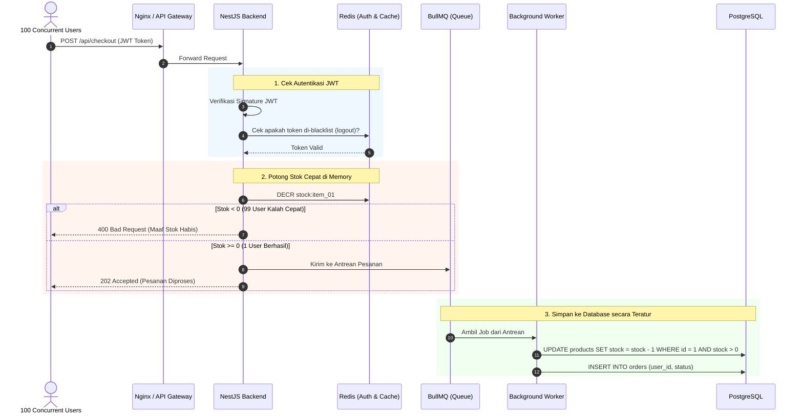

# WORK SAMPLE TEST
## FULLSTACK DEVELOPMENT & BUSINESS SYSTEMS
*Senior Fullstack JavaScript / React Engineer Role | Technical & Domain Assessment*

| Informasi | Detail |
| :--- | :--- |
| **Nama Kandidat** | Nurul Hidayatullah |
| **Posisi** | Fullstack React Engineer |
| **Format Repository** | `fullstack-work-sample-nurul-hidayatullah` |
| **Batas Waktu** | 3 - 5 Hari Kerja (GitHub Repository) |

---

## 🚀 Quick Start: Menjalankan Aplikasi React (Live Coding Soal #1)

Repository ini dilengkapi dengan aplikasi React fungsional di folder `/src` yang mensimulasikan dashboard inventori **5.000+ produk real-time** dengan perbandingan performa langsung.

```bash
# 1. Masuk ke folder project
git clone https://github.com/RulH19/fullstack-work-sample-nurul-hidayatullah.git
cd fullstack-work-sample-nurul-hidayatullah

# 2. Install seluruh dependencies
npm install

# 3. Jalankan development server
npm run dev
# atau
npm start
```

Aplikasi dapat diakses melalui browser pada URL: `http://localhost:3000`.

### 🎛️ 3 Mode Perbandingan Tabel Interaktif:
Tepat di atas metric card pada dashboard, terdapat **Tab Switcher** interaktif untuk membandingkan 3 pendekatan tabel secara *real-time*:

1. **Vanilla (Tanpa Hooks / No Virtualization)** — [`src/components/VanillaProductTable.tsx`](./src/components/VanillaProductTable.tsx)
   * Dengan valina dom yang di render adalah seluruh data yaitu 5.000+ raw sekaligus ke browser tanpa virtualisasi dan tanpa memoization. sehingga ketika user melakukan perubahan semua akan di render ulang yang meyebabkan lagging
2. **react-window (FixedSizeList)** — [`src/components/ReactWindowProductTable.tsx`](./src/components/ReactWindowProductTable.tsx)
   * React-windows adalah virtualisasi klasik berbasis komponen wrapper (`FixedSizeList`) yang merender data berdasarkan tinggi dari window jika sebuah window di set tinggi yang dapat terlihat sebanyak 12 maka ~12 nodes di layar akan di render. Sehingga browser jauh lebih enteng 
3. **useVirtualizer (@tanstack/react-virtual)** — [`src/components/OptimizedProductTable.tsx`](./src/components/OptimizedProductTable.tsx)
   * useVirtualizer adalah Virtualisasi modern berbasis headless hook yang fleksibel, fungsinya sama seperti react-windows hanya merender node yang terlihat saja. Namun bedanya tinggi dari window yang lebih dinamis dan bisa mengatur node tambahan yang mau dirender. Sehingga ketika kita scroll item yang dibawa sudah siap tampil tidak memunculkan putih terlebih dahulu karena belum dirender

---

# DAFTAR SOAL EVALUASI (5 SOAL)


## Soal #1: Optimasi Performa & State Management React (Live Coding / Implementation)
**Kategori:** *Frontend React JS*

### Skenario:
Sebuah dashboard e-commerce memiliki komponen tabel produk yang menampilkan 5.000+ data secara real-time. Setiap kali ada perubahan kecil pada satu item (misal: perubahan status stok), seluruh komponen dashboard mengalami re-render yang parah (lagging). Jelaskan diagnosa teknis Anda dan buatlah solusi berupa komponen React.

### Poin Jawaban / Persyaratan Essay:
* Jelaskan penyebab utama unnecessary re-render pada React saat menangani dataset besar.
* Implementasikan contoh React Component (Gunakan Hook seperti useMemo, useCallback, React.memo, atau Virtualization seperti react-window) di dalam file README / folder /src.
* Jelaskan strategi state management yang tepat agar update item individual tidak memicu re-render global.


---

### Jawaban Soal #1:

* Penyebabnya adalah parent component update : secara default ketika parent komponen me render maka seluruh childnya akan iktu di render ulang secara rekursif kecuali di cegah. Oleh karena itu agar komponent child tidak ikut di render ulang cukup komponent tertentu ada beberapa solusi 
1. Membungkusnya pada sebuah react.memo(), useMemo dan useCallback agar component tidak di render ulang karena jika kita tidak menggunakan itu maka komponent akan di render ulang.
2. Menggunakan key namun jangan menggunakan value dari index karena kurang efisien jadi gunakan lah id yang unik 
3. Gunakan virtualization agar merender item yang terilihat di viewport
* Implementasi react component dengan hooks
1. useMemo = berfungsi agar memoize atau memngingat sebuah objek yang sudah di buat agar tidak di buang ulang di memori setiap kali parent di render ulang kecuali dependencies benar benar berubah 
```tsx
const itemData = useMemo<ItemDataPayload>(
  () => ({ productIds, productsById, onUpdateStock }),
  [productIds, productsById, onUpdateStock]
);
```
2. useCallback = memcache fungsi antar render dengan memastikan alamat memory stabil sehingga child yang di bungkus react.memo tidak menaggangap props fungsi tersebut baru
```tsx
const VirtualRow = useCallback(
  ({ index, style, data }: ListChildComponentProps<ItemDataPayload>) => {
    const productId = data.productIds[index];
    const product = data.productsById[productId];
    if (!product) return null;
    return (
      <div style={style}>
        <ProductRow product={product} onUpdateStock={data.onUpdateStock} />
      </div>
    );
  },
  []
);

```
3. react.memo = adalah komponent hight order untuk mencegah child rerender jika props berubah 
```tsx
export const ProductRow = React.memo(
  PlainProductRow,
  (prevProps, nextProps) => {
    // Hanya re-render jika data esensial item ini benar-benar berubah
    return (
      prevProps.product.id === nextProps.product.id &&
      prevProps.product.stock === nextProps.product.stock &&
      prevProps.product.status === nextProps.product.status &&
      prevProps.onUpdateStock === nextProps.onUpdateStock
    );
  }
);

```
4. useVirtualizer = untuk menampilkan atau merender component sesuai dengan yang terlihat di view port dan juga dapat merender beberapa item yang belom terlihat agar ketika di scroll tidak perlu menunggu render lagi dengan menggunakan overscan 
```tsx
const parentRef = useRef<HTMLDivElement>(null);
const rowVirtualizer = useVirtualizer({
  count: productIds.length,
  getScrollElement: () => parentRef.current,
  estimateSize: () => 64,
  overscan: 0,
});

return (
  <div ref={parentRef} style={{ height: '560px', overflow: 'auto' }}>
    <div style={{ height: `${rowVirtualizer.getTotalSize()}px`, position: 'relative' }}>
      {rowVirtualizer.getVirtualItems().map((row) => (
        <div key={row.key} style={{ position: 'absolute', transform: `translateY(${row.start}px)` }}>
          <ProductRow product={productsById[productIds[row.index]]} />
        </div>
      ))}
    </div>
  </div>
);

```
5. react.windows = sama seperti virtualizer untuk merender component yang terlihat namun lebih kaku karena kita harus menentukan sebuah fixed list sehingga ketika kita scroll akan ada beberapa ms waktu merender component yang baru terlihat 
```tsx
const itemData = useMemo(() => ({ productIds, productsById, onUpdateStock }), [productIds, productsById, onUpdateStock]);

const VirtualRow = useCallback(({ index, style, data }: ListChildComponentProps) => (
  <div style={style}>
    <ProductRow product={data.productsById[data.productIds[index]]} />
  </div>
), []);

return (
  <List height={560} itemCount={productIds.length} itemSize={64} width="100%" itemData={itemData}>
    {VirtualRow}
  </List>
);

```
* **Strategi State Management:**
1. Normalisasi Struktur Data (Normalized State / Hash Map)seperti pada :
   * *Implementasi di kode (`useInventory.ts`):* Data tidak disimpan sebagai satu array besar `Product[]`, melainkan dinormalisasi menjadi dua bagian:
     - `allIds: string[]`: Menyimpan urutan ID produk. Referensi array ini **stabil dan tidak berubah** saat isi item di-update.
     - `productsById: Record<string, Product>`: Struktur lookup O(1) berbasis key ID.
   * *Dampaknya:* Ketika stok satu item di-update, kita cukup memperbarui key `productsById[id]` tanpa perlu membuat array ID baru, sehingga container list tidak merender ulang seluruh baris.
2. **Pemisahan State (State Splitting):**
   * Memisahkan state data inventory (`productsById`) dengan state input UI seperti pencarian (`searchTerm`). Dengan demikian, filter teks tidak mengganggu data asli, dan update data real-time tidak mereset filter.
3. **Opsi Lanjutan / Scalability (Selector-based / Atomic State):**
   * Untuk skala yang lebih masif lagi, strategi dapat ditingkatkan menggunakan library seperti **Zustand** atau **Jotai**. Setiap baris tabel (`ProductRow`) dapat me-subscribe secara atomik hanya ke ID-nya sendiri (`useProduct(id)`), sehingga saat stok item A berubah, hanya row A yang mendengar notifikasi tanpa menyentuh parent component sama sekali.

---

## Soal #2: Arsitektur Backend, Autentikasi JWT, & High-Concurrency Scaling
**Kategori:** *Backend Architecture & Security (Bebas Tech Stack)*

### Skenario:
Sistem Anda memproses ribuan permintaan per detik (*traffic spike*) saat promo Flash Sale. Backend Anda (bebas menggunakan Node.js/Express, Go, Python, Java, atau PHP) mengelola autentikasi berbasis Stateless JWT dan transaksi database.

### Poin Jawaban / Persyaratan Essay:
* Bebas memilih tech stack Backend. Sebutkan pilihan Anda dan berikan alasannya.
* Bagaimana Anda menangani mekanisme Token Revocation (Logout / Invalidation) pada JWT tanpa merusak sifat stateless dari JWT itu sendiri?
* Jelaskan strategi penanganan 'Race Condition' saat 100 user membeli 1 sisa barang yang sama secara bersamaan pada database SQL / NoSQL pilihan Anda.
* Sertakan diagram alur ringkas (Text / Mermaid.js) untuk arsitektur backend yang Anda usulkan.

---

### Jawaban Soal #2:

* NEST JS karena 
 1. Arsitektur enterprise & modular : menyediakan arsitektur berbasis DI, modularitas dan pipe & quards yang terstruktur
 2. Type safety end to end : menggunakan DTO dengan class validator hingga ORM/Query builder jadi tipe data dijamin memiliki keamanan payload yang tinggi
 3. Perform tinggi via fastify adapter :  mampu meningkatkan throughput hingga 2x lipak dalam menangani ribuan concurent
 4. Data integrity : Postgre sql menjamin integritas transaksi melalu dukungan acit dan relasional yang kuat
* Dengan memberikan JWT yang diberikan masa berlaku sangat singkat sehingga validasi dapat di lakukan tanpa hitdatabase sama sekali
* Dapat merubah flow query yang tadinya ambil stok dulu baru kurangin menjadi langsung kurangin didatabase dengan syarat stok masih ada. Bisa juga dengan membuat nya menjadi queu jadi akan di proses satu persatu 
```sql
Langsung kurangin stoknya 
   UPDATE products 
   SET stock = stock - 1 
   WHERE id = 'PROD-001' AND stock > 0;

Jangan ambil dulu baru kurangin 
  SELECT stock FROM products WHERE id = 'PROD-001';
  UPDATE products SET stock = 0 WHERE id = 'PROD-001';
```
* mermaid diagram 


---

## Soal #3: Strategi Integrasi API, Webhook Reliability, & Resiliency
**Kategori:** *System Integration & Fullstack Communication*

### Skenario:
Aplikasi Anda terintegrasi dengan Payment Gateway pihak ketiga via Webhook. Dalam beberapa kasus, Webhook dari Payment Gateway mengalami failure (timeout atau network glitch), sehingga status pembayaran user tidak ter-update.

### Poin Jawaban / Persyaratan Essay:
* Rancang mekanisme 'Idempotency' pada endpoint Webhook backend Anda agar transaksi tidak terproses ganda.
* Jelaskan strategi fallback/retry mechanism (misal: Cron Job / Polling / Dead Letter Queue) untuk memverifikasi pembayaran yang menggantung.
* Bagaimana Frontend React mengkomunikasikan status pembayaran ini secara smooth kepada user tanpa perlu terus-menerus membebani server (misal: Polling vs WebSocket vs Server-Sent Events)?

---

### Jawaban Soal #3:

* Setiap event di webhook selalu membawa id unik dari transaksi > saat webhook masuk, backend melakukan pengecekan status transaksi terlebih dahilu di database (-Jika statusnya sudah paid maka backend tidak melakukan update melainkan kembalikan status OK ke payment gateway dan berhenti kirim retry webhook , -Jika status masih pending maka update staus menjadi paid didalam database) > terapkan juga simpan id unik tersebuth selama beberapa jam untuk menahan request ganda yang masuk di detik sama persis
* 
* Agar frontend dapat secara smooth mendapatkan response dari api dan agar user tidak perlu hit terus menerus yang akan membebani server kita bisa menggunakan server-sent Events karena dengans Server-sent events atau sse adalah komunikasi satu arah dari server dan benar benar ringan di bandingkan websocket, atau bisa juga pake smartpolling dengan interval detik yang bertama atau dikali dengan set timeout  

---

## Soal #4: Evaluasi TCO (Total Cost of Ownership) & Trade-off Monolith vs Microservices
**Kategori:** *Business & Technical Decision Making*

### Skenario:
Manajemen meminta tim Anda untuk mendesain ulang (*refactor*) aplikasi e-commerce monolith yang saat ini berjalan dengan biaya server $150/bulan. Tim mengusulkan untuk langsung migrasi ke Cloud-Native Microservices (Kubernetes, AWS Lambda, Managed Databases).

### Poin Jawaban / Persyaratan Essay:
* Lakukan analisis Total Cost of Ownership (TCO): Apakah migrasi ini secara bisnis menguntungkan untuk startup skala awal-menengah?
* Sebutkan hidden costs (biaya tersembunyi) dari arsitektur Microservices, baik dari segi infrastruktur maupun operational effort tim engineering.
* Berikan rekomendasi arsitektur kompromi (hybrid / modular monolith) yang paling efisien dari segi biaya infrastruktur dan kecepatan deliver feature.

---

### Jawaban Soal #4:

* Untuk startup skala kecil - menengah tidak perlu untuk migrasi ke cloud native karena biaya yang di hasilkan akan melonjak drastis dan belom ada jaminan lonjakan tersebut di sertai dengan kenaikan omset yang sesuai, Sehingga untuk skala kecil - menengah masih lebih bagus jika menggunakan biaya server dengan langganan 150 dolar perbulan karena yang dibutuhkan saat ini produk cepat dan efisien bukan kompleksitas infrasturktur skala enterprise
* Biaya 
1. infrastruktur : biaya transfer antar service dan biaya dari manage kubernetes control plane
2. Operasional : rekrut orang senior khusus merawat infrastruktur, proses debugging perlu waktu lama karena lebih sulit, ci/cd pipeline yang rumit 
* Gunakan modular monolith dengan memisahkan folder permodule, lakukan single deploy agar berjalan dalam satu runtime/ server yang sama. Agar all in di satu server dibandingkan di banyak server namun memilii spek yang lebih rendah dibanding dengan sastu server
---

## Soal #5: Prioritisasi Feature, Metrik Software (LTV/CAC), & Handling Tech Debt
**Kategori:** *Product Domain & Software Business Metrics*

### Skenario:
Tim Product Manager menginginkan 3 fitur baru diluncurkan dalam sprint ini untuk mengejar target CAC (Customer Acquisition Cost). Namun, tim Engineering menemukan Technical Debt parah di codebase React & Backend yang berisiko menyebabkan server down.

### Poin Jawaban / Persyaratan Essay:
* Bagaimana Anda sebagai Lead/Senior Developer mengkomunikasikan dampak Technical Debt ini kepada Product Manager dan Stakeholder Non-Teknis?
* Jelaskan hubungan antara kualitas codebase / sistem reliabilitas dengan metrik bisnis seperti Churn Rate dan Customer Lifetime Value (LTV).
* Berikan framework / langkah prioritisasi konkret untuk membagi kapasitas sprint antara pengerjaan Fitur Bisnis Baru vs Refactoring Technical Debt.

---

### Jawaban Soal #5:

* menyampaikan resiko kerugian jika di paksa menambah fitur baru agar di luncurkan dalam sprint. Seperti : Kode kita sekarang kayak rumah yang fondasinya retak. Kalau kita tambah 3 fitur sekaligus, ada risiko server tumbang. Kalau server tumbang pas lagi kampanye, uang iklan kita kebuang dan pengguna baru kabur.
* langkah prioritasi 
1. Pilah technical debt berdasarkan risiko. Yang bisa bikin server down wajib dikerjakan sekarang, yang cuma bikin kerja lambat dijadwalkan, yang sekadar soal kerapihan masuk backlog.
2. Urutkan berdasarkan dampak dan usaha. Fitur dan perbaikan dinilai dengan ukuran yang sama, lalu yang dampaknya besar dan usahanya kecil dikerjakan duluan.
3. Bagi kapasitas sprint. Untuk sprint ini karena ada risiko besar, sekitar 50% fitur dan 50% perbaikan kritis. Untuk sprint biasa, 70% fitur, 20% technical debt, 10% cadangan untuk bug.
4. Evaluasi tiap sprint. Cek apakah error berkurang dan server lebih stabil, lalu sesuaikan pembagiannya di sprint berikutnya.

